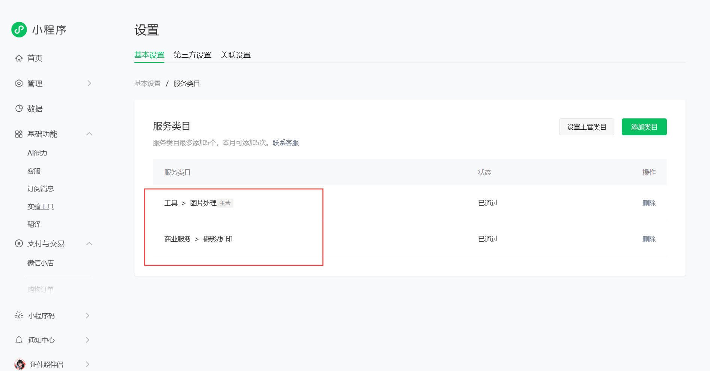

# 🔍预览：

# 📝项目介绍

# 
证件照伴侣 V2

让大家久等了，V2版本终于和大家见面了！

**相关项目**：
- 小程序后端V2：https://github.com/no1yu/HivisionIDPhotos-wechat-weappV2
- 小程序管理员网页后台V2：https://github.com/no1yu/zjzAdminV2
-  HivisionIDPhotos：https://github.com/Zeyi-Lin/HivisionIDPhotos
-  HivisionIDPhotosPro：https://github.com/no1yu/HivisionIDPhotosPro

------

# ⭐最近更新

- 2026.10.08：对齐探索处理页文案和示例人物
  - 探索处理页的输入框标题和占位文案与 photoOneV2 保持一致，移除 photoOneV2 没有的三处底部提示
  - 首页和规格详情共用官网原图中的示例人物，保留原人物表情和发型，页面布局不变
  - 人物素材保存为本地 JPG，替换原 PNG，减少主包资源大小
  - 涉及代码端：仅 photoTwoV2 微信小程序端，photoOneV2 和各后端未改动

- 2026.10.08：修复页面交互和下载信息展示问题
  - 相机页增加提交锁，避免“使用照片”重复上传、制作和跳转，并在流程结束后释放提交状态
  - 自定义尺寸页增加提交锁和按钮加载状态，避免重复保存
  - 个人中心同步公众号开关，关闭已停用的公众号弹窗并恢复底部导航；二维码地址更新后清除旧的加载失败状态
  - 下载弹窗补齐儿童装说明，避免显示 undefined
  - 涉及代码端：仅 photoTwoV2 微信小程序端，Java 后端、Python 服务、PHP 管理后台和 photoOneV2 未改动

- 2026.10.06：增加虚拟支付，调整图片编辑页布局，修复下载成功后的弹窗消失bug
- 2026.09.01：V2版本正式发布

------

# 🔧部署

微信开发者工具打开项目后，修改两处就好啦

## 隐私协议

## 客服配置

## 服务类目

## 📧其它

您可以通过以下方式联系我:

QQ: 24677102

微信：webxuan

QQ群：151601935
